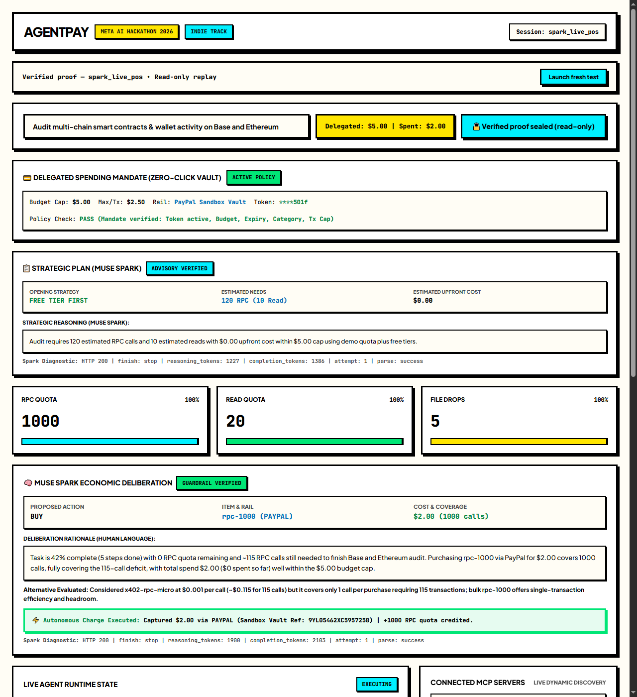
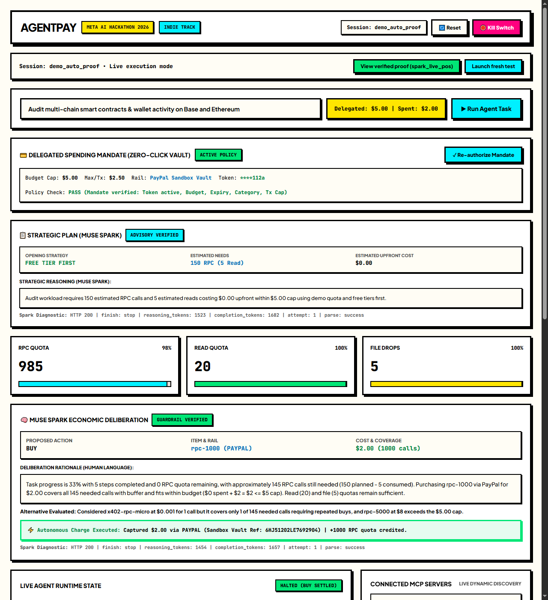

# AgentPay

Autonomous operating budget delegation and quota procurement for AI agents.

**Live Demo**: [agentpay.skuuy.com](https://agentpay.skuuy.com)

---

## 60-Second Judge Walkthrough

To verify autonomous execution, spending guardrails, and real PayPal Sandbox settlement without running any live charges:

1. **Primary Proven Replay ([`spark_live_pos`](https://agentpay.skuuy.com/?session=spark_live_pos))**:
   - Header badge: `Verified proof • Read-only replay`
   - Quota: `1000 / 1005` RPC units refilled
   - Spend: `$2.00` settled out of `$5.00` delegated cap (`$3.00` remaining)
   - Spending Mandate: `****501f` (PayPal Sandbox Vault)
   - Spend Ledger: 15 entries documenting initial setup, demo quota consumption, clean exhaustion pause, Spark economic deliberation, and real capture
   - Official Visual Receipt: Capture reference `9YL05462XC5957258` generated via Meta Muse Image stored in R2
   - Narrative Financial Report Card: Synthesized by Meta Muse Spark summarizing $5.00 cap / $2.00 spent / $3.00 remaining / 1 settled purchase
   - Replay Safety: Run and Reset buttons are permanently locked server-side (HTTP 403 `SESSION_SEALED`).
2. **Autonomous End-to-End Replay ([`demo_auto_proof`](https://agentpay.skuuy.com/?session=demo_auto_proof))**:
   - Status badge: `HALTED (BUY SETTLED)`
   - Quota: `985 / 1005` RPC units (resumed task execution consumed 20 calls post-buy)
   - Autonomous Receipt: Capture reference `6HJ51202LE7692904` automatically triggered and generated post-settlement
3. **Interactive Fresh Session ("Launch fresh test")**:
   - Clicking **Launch fresh test** provisions a new isolated session (`demo_xxxxxx`).
   - SESSIONS FAIL CLOSED: Without an authorized mandate, purchase attempts fail closed before any charge (zero charges without explicit human consent). This is a core safety guarantee, not a defect.
   - *Note on Initial Loading*: On cold load, default placeholder counters may display briefly before the real state snapshot populates from the Durable Object (~20 seconds).

---

## Overview

AI agents executing multi-step tasks often hit external API rate limits, RPC ceilings, or compute boundaries mid-execution. Current systems either abort the workflow or interrupt the operator with repeated approval prompts for minor top-ups.

**AgentPay** introduces **delegated economic agency**. An operator assigns an operating budget and policy mandate once. When the agent exhausts a resource mid-task, it evaluates its remaining workload, assesses live pricing options, procures the required quota within its authorized limits, and resumes execution seamlessly.

```
                  ┌─────────────────────────────────────┐
                  │      DELEGATED OPERATING BUDGET     │
                  │   (Operator signs mandate once)     │
                  └──────────────────┬──────────────────┘
                                     │
                                     ▼
                  ┌─────────────────────────────────────┐
                  │          SESSION RUNTIME            │
                  │   State Machine & Quota Ledger      │
                  └──────────────────┬──────────────────┘
                                     │
           ┌─────────────────────────┼─────────────────────────┐
           ▼                         ▼                         ▼
   🧠 REASONING CORE         ✋ TOOL EXECUTION          💳 PAYMENT RAILS
   Meta Muse Spark          Config-driven MCP client   PayPal Orders v2 Vault
   (muse-spark-1.3)         invoking runtime tools     & x402 Base USDC
```

---

## Proven Settlement Evidence

AgentPay does not simulate payments. Three live purchases were executed against PayPal Sandbox Orders v2 Vault rails, cross-verified between the AgentPay zero-log spend ledger and PayPal Sandbox developer activity:

1. **`spark_live_pos` (29 Oct 2026 19:11 WIB)**:
   - Capture Reference: `9YL05462XC5957258`
   - Settlement: `$2.00 USD` for `rpc-1000` pack (+1000 RPC quota)
   - Status: COMPLETED, verified on PayPal Sandbox Orders v2 Vault
2. **`demo_fresh_gate` (30 Oct 2026 06:45 WIB)**:
   - Capture Reference: `61H39800D9715751F`
   - Settlement: `$2.00 USD` (rehearsal proof pre-fix)
3. **`demo_auto_proof` (30 Oct 2026 07:34 WIB)**:
   - Capture Reference: `6HJ51202LE7692904`
   - Settlement: `$2.00 USD` for `rpc-1000` pack (+1000 RPC quota, 985 remaining after 20 resumed steps)
   - Automated Artifacts: Autonomous receipt generation via Meta Muse Image (`muse-image-1.0`) and financial report card via Meta Muse Spark (`muse-spark-1.3`).

> [!NOTE]
> **Sandbox Transparency**: PayPal Sandbox currency represents test funds, fully public and publishable by design.
> **Honest Scope Disclosures**:
> - **Concurrency Scope**: Idempotency is enforced strictly in application logic via decision ID and transaction deduplication; it has not undergone high-concurrency distributed load testing.
> - **Economic Scope**: Purchasing a 1000-unit pack for $2.00 ($0.002/unit) versus micro calls at $0.001/call does not claim dollar-level savings; its primary value is single-settlement transaction efficiency, reduced latency overhead, and autonomous operating headroom within delegated bounds.

### Live Proof Screenshots

| Primary Proven Replay (`spark_live_pos`) | Autonomous End-to-End (`demo_auto_proof`) |
| :---: | :---: |
|  |  |

*(Note: Live demo walkthrough video will be recorded and linked here on November 2 by Arby Pratama R.)*

---

## Autonomous Lifecycle: PLAN → EXECUTE → DELIBERATE → BUY

1. **Mandate Setup (Human-Gated Authorization)**: The human operator configures spending limits ($5.00 default cap, $2.50 max per transaction) and clicks **Authorize with PayPal (Sandbox)**. The session runtime requests a PayPal Vault setup token via the Payment Method Tokens API and exchanges it upon payer approval for a secure payment method token. Without an authorized mandate, the session is in a "NO MANDATE" state and all purchase attempts fail closed before any charge.
2. **Strategic PLAN (Advisory Only)**: At session initialization before any execution, **Meta Muse Spark (`muse-spark-1.3`)** assesses task complexity, evaluates free-tier allowances, estimates resource needs, and proposes an opening strategy (`free_tier_first`). PLAN is strictly advisory: it never charges, never buys, and automatically falls back to default steps if model output is malformed.
3. **Execution & Metering**: The agent carries out task steps using standard Model Context Protocol (MCP) tool calls (`skuuy_rpc`, `search`). Every successful execution decrements sequentially inside the single-threaded Durable Object handler the corresponding resource quota in the `AgentSession` Durable Object. Failed calls never deduct quota.
4. **Clean Exhaustion Pause**: When a quota bucket hits zero, execution pauses cleanly (`paused_quota_exhausted`). No guessed charges or overspending can occur.
5. **Economic Deliberation**: The agent triggers **Meta Muse Spark (`muse-spark-1.3`)**. The model analyzes remaining workload, completion progress, live catalog pricing (e.g. micro vs. pack volume), and outputs strict JSON with numerical reasoning to select the optimal procurement option.
6. **Mandate & Guardrail Checks**: Before any charge is initiated, the code strictly validates in sequence:
   - Budget cap compliance (`cost + spentUsd <= cap`)
   - Live catalog price and item allowlist match
   - Mandate token validity (rejects missing or placeholder tokens), expiry, allowed categories, and per-purchase ceiling ($2.50 max/tx).
   - If checks fail, the session moves to `needs_mandate_amendment` with zero charge.
7. **Autonomous Buy & Quota Refill**: Once validated, the runtime executes autonomous settlement via PayPal Orders v2 Vault capture (or x402 on-chain USDC when enabled), adds refilled quota according to the catalog mapping, records a `TRANSACTION` ledger entry, and increments `spentUsd`.
8. **Auto-Resume**: The agent loop automatically resumes execution immediately with refilled quota without requiring operator intervention.

---

## Architecture

- **Session Coordinator**: A single-threaded, stateful actor (`AgentSession` Durable Object) providing authoritative state management, sequential quota accounting, and an operator freeze button (public demo endpoint; sealed proof sessions are protected server-side).
- **Reasoning Core**: Powered by **Meta Muse Spark (`muse-spark-1.3`)** for strategic planning, resource estimation, and economic deliberation.
- **Visual Receipts**: Autonomous visual payment receipt card rendering via Meta Muse Image (`muse-image-1.0`) persisted directly to R2 storage.
- **Engineered with Meta Tooling**: Core runtime, state machine coordination, and agent loops were constructed using Meta's **Muse Code** coding agent.
- **Config-Driven MCP Client**: Protocol-compliant (`2025-11-25`) Streamable HTTP client that dynamically discovers tools at runtime via `tools/list` across configured endpoints.
- **Dual Payment Rails**:
  - **PayPal Orders v2 & Vault Spending Mandate**: Proven primary rail for zero-click autonomous checkout for quota packs within human-authorized spending limits.
  - **x402 Base USDC**: Auxiliary on-chain micropayment rail implemented behind a fail-closed gate; production on-chain settlement is not yet verified and is disabled by default (`X402_NOT_IMPLEMENTED`).
- **Zero-Log Spend Ledger**: Privacy-first financial auditing. Only lean metadata (timestamps, units, costs, rails, rationale) is stored. Request payloads, response data, payment tokens, and file contents are never persisted.

---

## Security & Audit Hardening

Following independent security audits, AgentPay incorporates multi-layered defense-in-depth safeguards:

- **Server-Side Sealed Session Protection**: Sealed proof sessions (`spark_live_pos`, `demo_auto_proof`, `demo_fresh_gate`) are immutable. All mutating API requests (`/init`, `/freeze`, `/step`, `/run`, `/deliberate`, `/plan`, `/buy`, `/mandate`, `/report`, `/backfill`) return HTTP 403 `SESSION_SEALED` at both the Worker router and Durable Object dispatcher. Public read endpoints remain open for judge inspection.
- **SSE Token Leak Prevention**: Sensitive payment method tokens (`_vaultToken`) are recursively sanitized from all Server-Sent Events (SSE) broadcasts (`freeze_toggled`, `quota_exhausted`, `snapshot`), state APIs, and public payloads. Only masked tokens (e.g. `****501f`) are ever exposed.
- **Deliberation-Bound Settlement**: Public `POST /api/session/:id/buy` requests only settle the active, model-deliberated decision (`session.latestDecision`) with `guardrailStatus === 'accepted'`. Fabricated or mismatched external decision payloads are strictly rejected (`NO_VALID_BUY_DECISION` / `DECISION_MISMATCH`).
- **Fail-Closed Guarantees**: Any failure condition—missing credentials, missing mandate, expired mandate, placeholder token, price tampering, or unlisted items—fails closed before initiating any payment rail request.
- **Rate-Limited Mutation Endpoints**: Public write endpoints are rate-limited per client IP (10 requests/min for model-triggering endpoints like `/plan`, `/deliberate`, `/report`, `/backfill`; 60 requests/min for general state mutations) to prevent automated resource exhaustion (H2), while read routes remain unrestricted. Rate limiting is enforced per Worker isolate: the counters live in isolate memory, so the stated per-IP rates are best-effort abuse friction for a public demo, not a globally aggregated hard cap — a distributed attacker spreading requests across isolates could exceed the nominal rate.
- **Zero Simulation Policy**: There is no mock/simulation switch in production. All purchase paths require real valid rails or fail safely with zero spend and zero quota.

---

## Pre-existing Work Disclosure

In accordance with hackathon guidelines, pre-existing and event-built components are delineated as follows:

- **Pre-existing Work (Created prior to event)**:
  - `skuuy-mcp`: Hosted developer utilities and JSON-RPC relay (`https://mcp.skuuy.com/mcp`).
  - `checkout.skuuy.com`: Existing PayPal Orders v2 sandbox checkout rails and QuotaCoordinator.
  - x402 Base USDC facilitator rails (`bc_c61pqqgo`).
- **New Work Built During the Event (27 Oct – 4 Nov 2026)**:
  - AgentPay core runtime and state machine (`AgentSession` Durable Object).
  - Strategic Planner (`src/plan.js`) and autonomous Buy Executor (`src/buy-executor.js`).
  - Config-driven generic MCP client engine (`src/mcp-client.js`).
  - Autonomous deliberation engine and economic prompt integration with Meta Muse Spark (`src/brain.js`, `src/meta-adapter.js`).
  - PayPal Vault spending mandate verification and autonomous charge executor.
  - Real-time telemetry dashboard (`src/dashboard.js`) and zero-log spend ledger.
  - In-memory rate limiting and sealed proof session protection (`src/rate-limiter.js`, `src/index.js`).
  - All event-built code constructed using Meta's **Muse Code** coding agent.

---

## Project Structure

```
agentpay/
├── docs/
│   └── screenshots/      # Live dashboard replay proof screenshots
├── src/
│   ├── index.js          # HTTP routing, Server-Sent Events, Worker entrypoint
│   ├── session-do.js     # Session Coordinator Durable Object & spend ledger
│   ├── agent-loop.js     # Task execution lifecycle, PLAN init & auto-resumption
│   ├── plan.js           # Strategic task planning via Muse Spark (advisory only)
│   ├── brain.js          # Economic deliberation engine via Muse Spark
│   ├── buy-executor.js   # Mandate verification & autonomous purchase settlement
│   ├── receipts.js       # Visual receipt generator via Muse Image & R2 storage
│   ├── meta-adapter.js   # Standard Meta model client (muse-spark-1.3)
│   ├── mcp-client.js     # Generic Streamable HTTP MCP client
│   ├── rate-limiter.js   # In-memory sliding-window rate limiter (H2 abuse protection)
│   ├── dashboard.js      # Operator interface & real-time telemetry
│   └── types.js          # Shared schemas, constants, and status definitions
├── test/
│   └── agentpay.test.js  # 44-test integration & lifecycle suite
├── wrangler.toml         # Cloudflare Worker & Durable Object configuration
├── package.json
└── LICENSE
```

---

## API Endpoints

| Endpoint | Method | Description |
| :--- | :--- | :--- |
| `/` | `GET` | Operator Dashboard & real-time telemetry |
| `/api/session/:id/state` | `GET` | Current session state, quota balances, mandate, and ledger |
| `/api/session/:id/init` | `POST` | Initialize or reset session with custom quota and budget cap |
| `/api/session/:id/step` | `POST` | Execute a single agent loop step |
| `/api/session/:id/run` | `POST` | Execute agent loop steps against live MCP tools |
| `/api/session/:id/plan` | `POST` | Generate strategic plan via Muse Spark (advisory only) |
| `/api/session/:id/deliberate`| `POST` | Trigger economic deliberation upon quota exhaustion |
| `/api/session/:id/buy` | `POST` | Execute mandate-enforced purchase and refill quota |
| `/api/session/:id/receipts/:txId` | `GET` | Serve visual receipt image generated via Muse Image from R2 |
| `/api/session/:id/receipts/:txId/backfill` | `POST` | Backfill/regenerate visual receipt for verified successful buy |
| `/api/session/:id/report` | `POST` | Generate narrative financial audit summary via Muse Spark |
| `/api/session/:id/mandate` | `POST` | Authorize or update human-gated spending mandate |
| `/api/session/:id/mandate/setup-token` | `POST` | Create PayPal Vault setup token for buyer authorization |
| `/api/session/:id/mandate/paypal-callback` | `GET` | Handle buyer approval redirect and exchange for vault token |
| `/api/session/:id/mandate/exchange-token` | `POST` | Exchange approved setup token for vaulted payment token |
| `/api/session/:id/freeze` | `POST` | Emergency kill switch (operator freeze button; protected server-side on sealed sessions) |
| `/api/session/:id/unfreeze`| `POST` | Unfreeze session and restore execution |
| `/api/session/:id/stream` | `GET` | Real-time Server-Sent Events (SSE) telemetry stream |

---

## Environment Secrets

Secrets are configured via Worker environment bindings (never committed to repository):

- `META_MODEL_API_KEY`: API key for Meta Muse Spark model calls (`muse-spark-1.3`) and Visual Receipts (`muse-image-1.0`).
- `PAYPAL_CLIENT_ID`: PayPal Sandbox REST API App Client ID (set by operator).
- `PAYPAL_CLIENT_SECRET`: PayPal Sandbox REST API App Client Secret (set by operator).
- `X402_PAYER_SECRET`: *(Optional)* Payer private key for x402 Base USDC micropayments. When unset, the x402 path safely disables itself with a descriptive error while the PayPal Vault path remains fully operational.

> [!NOTE]
> **Zero Simulation Policy**: There is no simulation mode. A buy without PayPal keys, or with a placeholder mandate token, fails closed with no charge and no quota.

---

## Development & Testing

### Prerequisites

- Node.js 20+

### Setup

```bash
# Clone repository
git clone https://github.com/deaabie/agentpay.git
cd agentpay

# Run full 44-test suite
npm test
```

> [!NOTE]
> **Test Network Requirements**: Test 1 and Test 2 verify live network connectivity against remote MCP servers (`skuuy-mcp` and `ondocs`) and require an active internet connection. Tests 3 through 44 run entirely in-memory offline with deterministic mocking.

### Local Development

```bash
# Start local development server
npm run dev
```

---

## License

MIT © 2026 Skuuy Tools
